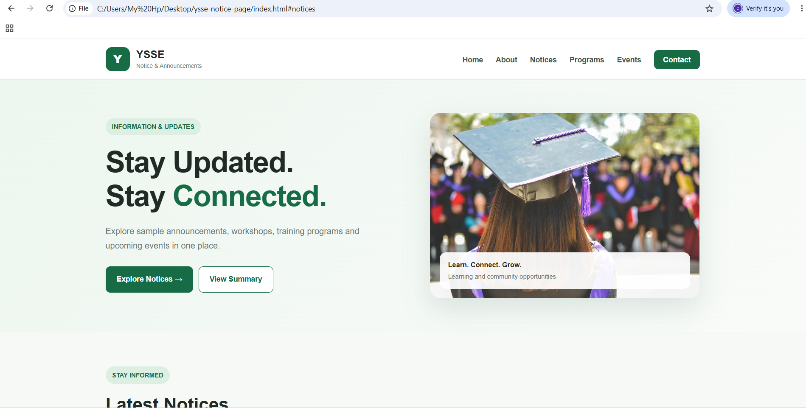
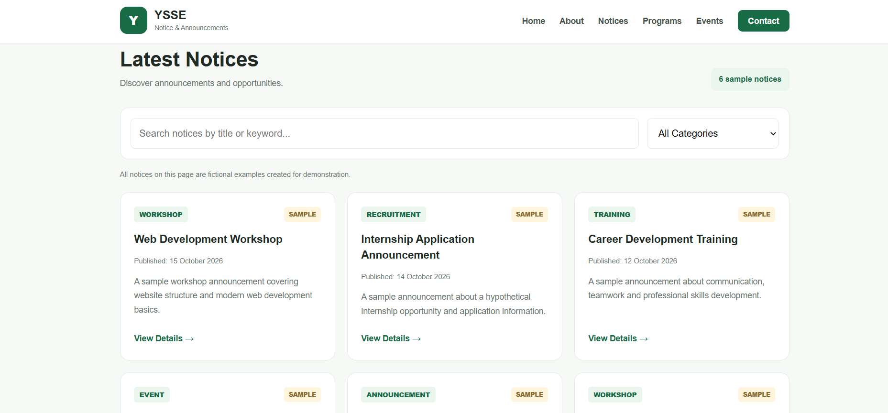
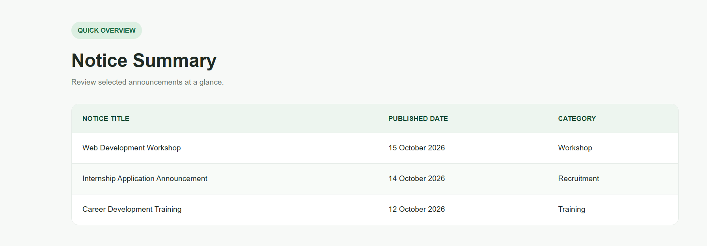
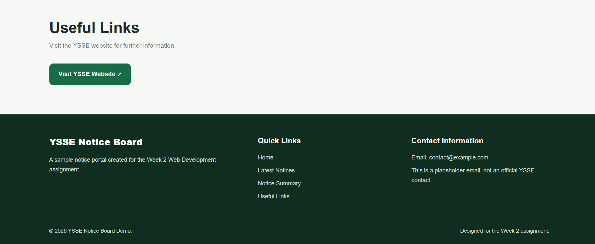

# YSSE Notice Board

A professional and responsive notice board website developed for the Week 2 Web Development assignment of the YSSE IT Department: Web Development & CMS Wing.

## Project Overview

The YSSE Notice Board is a sample website designed to organize announcements, workshops, training programs, recruitment information, and events in one place.

The project focuses on creating a user-friendly interface with semantic HTML, modern CSS styling, and interactive JavaScript functionality.

**Note:** All notices displayed on this website are fictional sample content created for educational purposes.

## Live Demo

Visit the deployed website:

[YSSE Notice Board - Live Website](https://choitydhar143.github.io/ysse-notice-page/)

## GitHub Repository

[View Source Code on GitHub](https://github.com/choitydhar143/ysse-notice-page)

## Screenshots

### Homepage


### Latest Notices


### Notice Summary


### Footer



## Technologies Used

- HTML5
- CSS3
- JavaScript

## Features

- Professional green-and-white design
- Responsive layout for desktop, tablet, and mobile
- Navigation bar with section links
- Hero section with an educational image
- Six sample notices
- Notice categories and publication dates
- Search notices by keyword
- Filter notices by category
- Interactive notice details popup
- Notice summary table
- Useful links section
- Footer with contact information
- Semantic HTML structure

## Project Structure

```text
ysse-notice-page/
├── index.html
├── style.css
├── script.js
├── README.md
└── screenshots/
    ├── notice-page.png
    ├── notice-cards.png
    ├── notice-summary.png
    └── notice-footer.png
```


## How to Run Locally

1. Download or clone this repository.
2. Open the project folder in Visual Studio Code.
3. Open `index.html` in a web browser.
4. Ensure an internet connection is available to load the external hero image.

No backend or package installation is required.

## HTML Structure

The project uses semantic HTML5 elements, including:

- `<header>` for the website header
- `<nav>` for navigation links
- `<main>` for the primary page content
- `<section>` for organizing content sections
- `<article>` for individual notices
- `<table>` for the notice summary
- `<footer>` for contact information and copyright

## CSS and JavaScript

CSS is used to style the page, create notice cards, define the color scheme, and provide responsive layouts.

JavaScript is used to implement keyword search, category filtering, notice count updates, and interactive notice details.

## Important Notes

- All notices are fictional sample announcements.
- The contact email is a placeholder and is not an official YSSE contact address.
- The website is a front-end demonstration and does not include a backend or database.
- The external hero image requires an internet connection.

## Author

Developed as an individual Week 2 Web Development assignment.

## License

This project was created for educational purposes.
